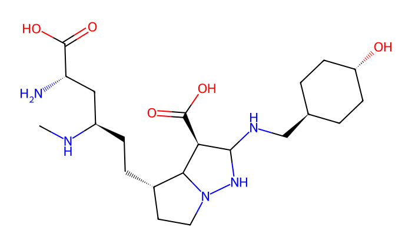

# PROTAC DecompDiff

这个项目用来整理 PROTAC 的 warhead 和 E3 ligand 数据，并运行 DecompDiff 的口袋条件分子生成。代码基于[原作者实现](https://github.com/bytedance/DecompDiff)，补充了数据处理、输入检查、结果导出和测试。

目前用的是原作者的预训练权重。表格处理和分子生成可以分别运行，但整理好的片段还没有接入训练；把任务名改成 `warhead` 或 `e3_ligand`，也不会让模型自动学会生成对应片段。

## 先跑一个小例子

需要 Python 3.10。这部分不用显卡，也不用下载权重。先克隆仓库并进入目录：

```bash
git clone https://github.com/songfy0118/protac-decompdiff-starter.git
cd protac-decompdiff-starter
python -m venv .venv
```

Windows PowerShell 激活环境：

```powershell
.venv\Scripts\Activate.ps1
```

Linux/macOS 使用 `source .venv/bin/activate`。如果 Windows 不允许执行激活脚本，下面命令中的 `python` 可以直接换成 `.venv\Scripts\python.exe`。

```bash
python -m pip install --upgrade pip
python -m pip install -r requirements-data.txt
python doctor.py
python -m unittest -v test_pipeline
python prepare_fragments.py --source-dir examples/table_inputs --source-map examples/table_inputs/sources.json --output-dir runs/demo
python verify_outputs.py --data-dir runs/demo
```

例子使用人为构造的简单分子，只用于检查程序。应得到 4 条片段记录、2 个母体分组、1 条配对记录，没有隔离记录。输出在 `runs/demo/`；再次运行时换一个新目录，例如 `runs/demo-02/`。

测试中有一项需要 PyTorch。只装数据依赖时，这一项会显示 `skipped`，其余测试应通过。

## 换成自己的数据

把原始表格放进 `data/raw/`，按[数据说明](docs/DATA.md)准备文件名映射，再执行同一条处理命令。原始研究数据没有上传到仓库，`examples/table_inputs/` 只是格式样例。

处理后先看 `summary.json` 的数量和 `validation_errors.csv` 的错误，再看 `fragments.csv`。要找某条片段来自哪里，用它的 `record_id` 查 `provenance.jsonl`，可以追到源文件和行号。

连接标记 `[R1]`、`[R2]` 会保留为 `[*:1]`、`[*:2]`。同一封端母体的不同连接位置会放进同一个数据集划分，避免直接重复。这个划分没有按靶点或分子骨架留出。

## 运行分子生成

完整环境、权重下载和目录要求见[推理说明](docs/INFERENCE.md)。装好以后可以先用仓库里的蛋白口袋和参考配体：

```bash
python run_endpoint.py --spec examples/test_spec.json --checkpoint assets/decompdiff.pt --output runs/endpoint-001 --samples 1
python verify_outputs.py --endpoint runs/endpoint-001
```

`candidates.sdf` 保存生成分子，`report.json` 记录重建结果，`run_manifest.json` 记录输入摘要和运行状态。运行结束不一定代表所有样本都重建成功，要检查报告中的 `reconstructed` 和每条结果的 `connected`。

`sample_results/` 保留了两次实际运行的结果：各生成一个样本，使用完整 1,000 步，均得到一个可读取的连通分子。这个样本量只能确认程序能跑，不能用来估计生成质量或成功率。



## 还差什么

新增 [9BIG 本地结构准备与固定端点检查](docs/FIXED_FRAGMENTS.md)：可准备参考结构、导出任务原子映射并检查候选是否保留固定片段与连接位置。包含不依赖研究原始数据的测试；这一检查模块尚未接入约束扩散生成。

要用于同学的具体课题，首先需要选定靶蛋白和 E3，并准备相应的结合结构、参考片段和 linker 连接位置。输入 PDB 和 SDF 必须在同一坐标系，不能把任意生成的配体构象直接当作结合姿态。

后面的主要工作是把这些数据接入训练，加入连接位点约束，再设置独立的评估集。当前代码没有完成 PROTAC 微调、连接位点保持、对接评估或活性验证。DecompDiff 的 arms/scaffold 分组也不能直接当作 warhead/E3 分组。

## 文档与代码

- [数据格式与错误处理](docs/DATA.md)
- [模型安装与推理](docs/INFERENCE.md)
- [测试记录](docs/VALIDATION.md)

常用入口是 `prepare_fragments.py`、`run_endpoint.py` 和 `verify_outputs.py`。`run_baseline.py` 用于官方数据基线；`doctor.py` 检查环境。上游代码保存在 `DecompDiff-main/`。

## 引用与许可

Guan 等，*DecompDiff: Diffusion Models with Decomposed Priors for Structure-Based Drug Design*，ICML 2023。[论文](https://proceedings.mlr.press/v202/guan23a.html)

保留上游 CC BY-NC 4.0 许可及文件内的第三方声明，详见 [LICENSE](LICENSE) 和 [THIRD_PARTY_NOTICES.md](THIRD_PARTY_NOTICES.md)。
